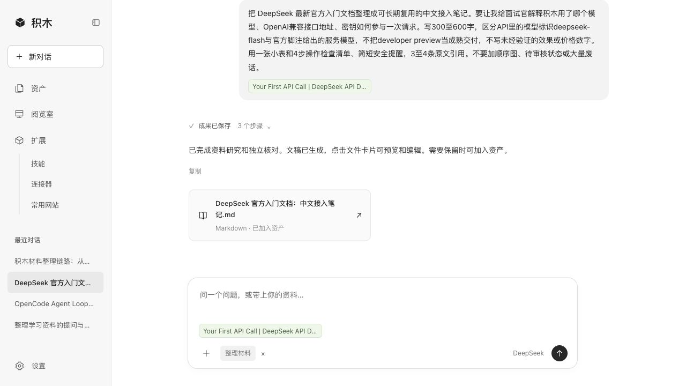
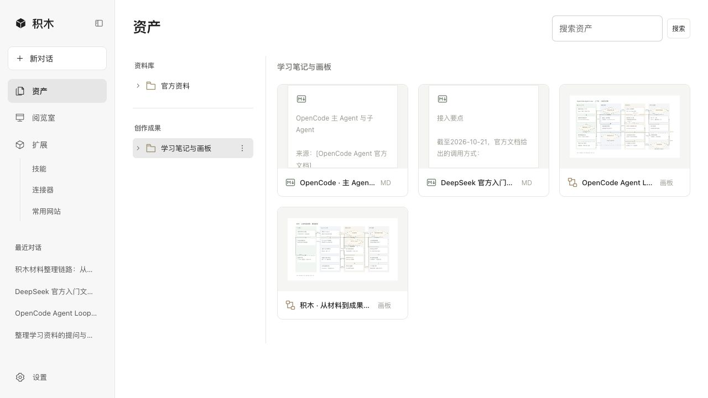
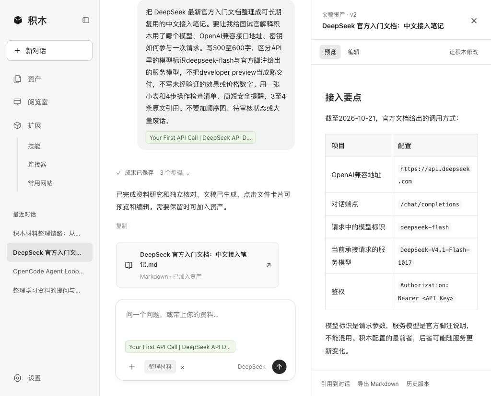
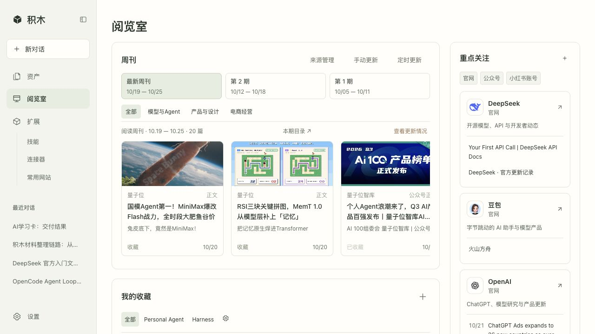
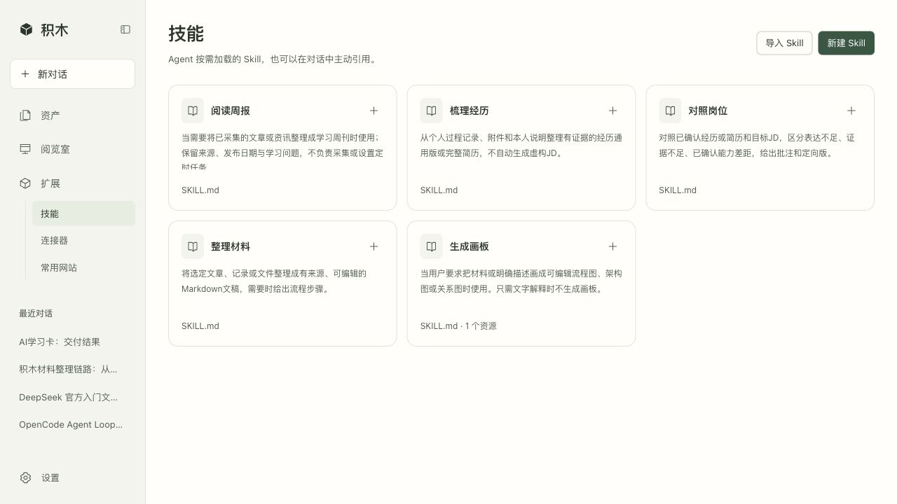
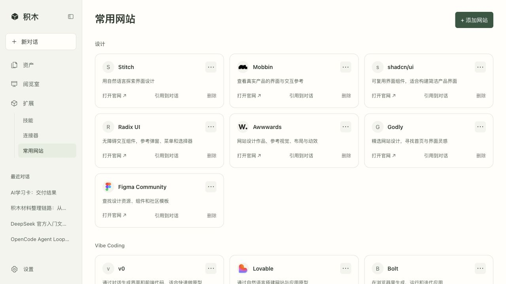
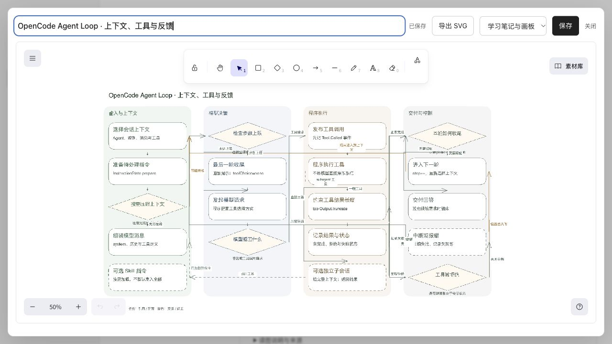

<div align="center">

# 积木 · Jimu

**对话驱动的个人 AI 工作台**

把零散材料整理成可编辑、可保存、可再次引用的文稿与画板。

[功能特性](#功能特性) · [界面预览](#界面预览) · [快速开始](#快速开始) · [技术架构](#技术架构)

</div>

## 项目介绍

积木面向个人学习、材料整理和求职准备，将文件管理、Agent 对话和成果编辑放在同一个工作空间中。你可以上传项目记录、文章或招聘 JD，在对话中引用材料和技能，生成阅读笔记、经历文稿或流程图，并按自己的目录保存。

项目基于 OpenCode 执行 Agent 任务，接入 DeepSeek，使用 Excalidraw 编辑画板。目前提供本地桌面版本，数据保存在自己的电脑上。

## 界面预览

<p align="center">
  <a href="docs/screenshots/2026-10-22/01-chat.jpg"></a>
  <br />主对话：从一个问题或一份材料开始
</p>

<table>
  <tr>
    <td width="50%" align="center"><a href="docs/screenshots/2026-10-22/02-assets.jpg"></a><br /><b>资产管理</b><br />文件夹、原始材料与创作成果</td>
    <td width="50%" align="center"><a href="docs/screenshots/2026-10-22/03-document.jpg"></a><br /><b>文稿预览</b><br />在对话旁阅读、编辑生成内容</td>
  </tr>
  <tr>
    <td align="center"><a href="docs/screenshots/2026-10-22/04-reading.jpg"></a><br /><b>阅览室</b><br />周刊、重点关注与个人收藏</td>
    <td align="center"><a href="docs/screenshots/2026-10-22/05-skills.jpg"></a><br /><b>技能管理</b><br />导入、编辑与引用 SKILL.md 技能包</td>
  </tr>
  <tr>
    <td align="center"><a href="docs/screenshots/2026-10-22/06-websites.jpg"></a><br /><b>常用网站</b><br />分类维护设计、开发与学习入口</td>
    <td align="center"><a href="docs/screenshots/2026-10-22/07-board.jpg"></a><br /><b>画板编辑</b><br />将流程图作为可编辑资产保存</td>
  </tr>
</table>

截图拍摄于 2026-10-22，来自当前本地运行版本。阅览室展示已采集的公开文章，文稿与画板为真实任务回看，画板经人工核对修正。点击图片可查看完整尺寸。

## 功能特性

- **对话与材料引用**：引用文件、文件夹和技能，支持普通问答、经历整理、JD 对照和阅读笔记生成。
- **可见的执行过程**：展示任务阶段、Agent 分工与实际工具调用，错误直接显示，不以模拟结果代替模型执行。
- **文稿与画板**：生成内容以文件卡片呈现，支持预览和编辑；由用户选择保存位置，加入资产后可再次引用。
- **资产管理**：分别组织原始资料与创作成果，支持子文件夹、拖动移动、文件预览和下载。
- **阅览室**：手动更新公开订阅源，或设置每天、每周定时更新；按日期浏览周刊，分类收藏文件、链接和画板。
- **网页采集**：粘贴链接读取正文、封面与日期，检查后存入指定目录；也可以通过本地 Browser Use MCP 打开网页，完成登录后读取当前文章。
- **扩展与偏好**：管理技能、常用网站和 MCP 配置；在设置中配置模型、回答偏好与三种配色。切换配色不改变布局与面板尺寸。

## 快速开始

### 环境要求

- macOS / Linux，Python 3.10+
- Node.js 18+ 和 npm
- OpenCode 可执行文件（当前流程基于 **1.19.3** 验证）
- 自己的 DeepSeek API Key

### 1. 获取项目并安装依赖

```sh
git clone https://github.com/Labixy1/jimu-workbench.git
cd jimu-workbench

python3 -m venv .venv
.venv/bin/python -m pip install pypdf pypdfium2
export JIMU_PYTHON="$PWD/.venv/bin/python"

npm install --prefix ui-board
node ui-board/build.mjs
```

### 2. 配置 OpenCode

从 [OpenCode Releases](https://github.com/anomalyco/opencode/releases) 下载对应系统的可执行文件，解压后放到 `vendor/opencode`：

```sh
chmod +x vendor/opencode
```

OpenCode 未打包在仓库内；其他版本可能需要适配。

### 3. 启动

```sh
.venv/bin/python server.py --port 8769
```

打开 `http://127.0.0.1:8769`，在设置中填写 DeepSeek API Key。模型调用会产生费用。

如果 OpenCode 的默认端口被占用：

```sh
.venv/bin/python server.py --port 8769 --engine-port 4099
```

### 使用流程

1. 在资产中上传材料，或在新对话中从本地添加文件。
2. 点击输入框旁的 `+`，引用资产与需要的技能，然后发送任务。
3. 打开生成的文件卡片，在右侧预览和修改。
4. 需要保留时加入资产，选择存放目录，后续继续引用。

本地启动后可打开 `/?showcase=1` 回看本轮公开资料与真实生成结果；这个副本只读，不调用模型，不包含私人材料。正常使用请打开 `/`。

网页手动采集扩展的安装说明见 [browser-clipper/README.md](browser-clipper/README.md)。

### Skills

在扩展 → 技能中查看和编辑 `SKILL.md`，也可导入单份 Markdown 或包含一个技能文件夹的 ZIP，导出后可复用到其他支持 Skill 的工具。技能包由 `name`、`description` 和执行方法组成，可附带 `references/`、`scripts/`、`assets/`。

Agent 先看到技能名称和用途，匹配任务时通过 OpenCode 的 `skill` 工具加载正文，再按需读取资源；在对话中主动引用的技能会直接加载，不跳转固定表单。每次任务冻结技能版本，修改不会影响已经开始的任务。**导入不执行脚本，也不授予连接器或文件写入权限**；当前脚本资源仅支持读取，依赖特定运行环境的第三方技能并非导入即可执行。

### 阅读与采集

- **公开来源**：阅览室 → 来源管理，填写标题与地址后测试。支持 RSS/Atom，也能识别网页公布的订阅源或读取具体文章；手动更新与定时更新共用一条采集链路。
- **当前文章**：阅览室 → 采集文章，或扩展 → 连接器 → Browser Use → 采集网页。先预览正文，再选择资产目录、是否加入阅览室及收藏分类；不自动保存。
- **阅读后使用**：打开文章可以做笔记、收藏、带入对话。带入的是已读取的正文；若只有摘要，会明确标注，不冒充全文。

以上采集与更新不调用付费模型。登录、验证码仍由用户完成；未读到正文时显示错误，不将拦截页保存为文章。

### 可选连接器

公开网页采集不需要安装额外工具。需要 Browser Use 时，在项目目录单独安装已验证的版本：

```sh
python3.12 -m venv .runtime/browser-use-env
.runtime/browser-use-env/bin/python -m pip install 'browser-use==0.13.11' 'mcp==2.1.1'
```

Browser Use 需要本机 Chrome/Chromium；使用积木独立的浏览器目录，不接管日常浏览器。无浏览器的环境请先按照 [Browser Use 文档](https://docs.browser-use.com/open-source/customize/integrations/mcp-server) 完成浏览器安装。

GitHub 在扩展 → 连接器中使用本机 `gh auth login` 登录，或配置单独的 Token。MCP 默认只读，连接后仍须测试实际读取；**导入 README 是独立功能，不代表 MCP 已连接**。如果官方 MCP 域名被组织网络策略拦截，需要按组织流程放行，不通过代理或其他地址绕过。

## 技术架构

```text
用户输入 + 所选材料 + 技能 + 回答偏好
                    │
              Python 本地服务
                    │
             OpenCode / DeepSeek
                    │
        文稿或画板 → 预览编辑 → 用户保存
                    │
              SQLite 与本地文件
```

前端使用原生 HTML、CSS 和 JavaScript，后端使用 Python 与 SQLite。普通对话由主 Agent 处理；材料整理任务由应用顺序编排研究、写作和核对会话，不是自主并行的 Agent 团队。上下文以用户选中的材料、近期对话和已保存偏好为主。

画板使用本地 Excalidraw 组件，不是 MCP 连接器。GitHub、Browser Use 等 MCP 的实际使用需要对应服务安装、授权和连接测试；常用网站是网址入口，不赋予 Agent 自动操作能力。

网页采集由积木自己的 Python 服务调用固定读取工具，普通网页与订阅源使用 HTTP 解析，登录页面使用本地 Browser Use MCP。正文与来源保存在本机，采集结果经用户选择才进入资产；再次引用时保留可追溯的原文版本。

```text
web/               前端界面与交互
server.py          本地服务入口
engine.py          OpenCode 会话与任务编排
context.py         任务上下文构建
reading_updates.py 周刊更新与本地定时调度
web_capture.py     网页预览、Browser Use 与用户确认保存
mcp_runtime.py     本地 MCP 传输与调用边界
skills/            SKILL.md 技能包与按需加载的资源
skill_packages.py  技能包校验、导入导出与隔离加载
ui-board/          Excalidraw 画板组件
browser-clipper/    手动网页采集扩展
tests/             自动化测试
```

## 当前限制与隐私

- 当前是本地 MVP，没有公网账户、用户隔离和生产部署方案，不应直接开放到公网。
- 可保存多种附件，但模型读取主要支持 TXT、MD、DOCX、文字型 PDF 和 HTML；图片 OCR、视频转写未实现。单文件上限 64 MB，PDF 文字提取最多 40 页。
- DOCX 编辑针对提取后的正文，不保留原始版式；上传原件不被覆盖。模型输出仍需用户核对。
- 周刊定时更新默认关闭，按北京时间运行，需要电脑和积木服务保持运行；只抓取公开来源，不自动调用付费模型。公众号、小红书支持用户打开单篇内容后采集，不承诺无人值守地更新整个账号。
- 正文、发布日期和封面以来源实际提供的信息为准；无封面留空，无准确日期标注采集日期。网站结构改变、签名链接过期或访问限制都可能导致读取失败。
- 本地数据与凭据位于 `data/`、`.runtime/`，不随仓库发布。远程模型会接收任务所需的上下文，请勿上传无权分享的材料。

## 开发与贡献

项目从个人使用场景出发，通过与 AI 交互迭代需求、界面与实现。欢迎通过 Issue 反馈问题；扩展任务能力可从 `skills/` 中的规则开始，界面与服务分别位于 `web/` 和 Python 模块中。

Python 单元测试：

```sh
.venv/bin/python -m unittest discover -s tests -q
```

测试中的确定性模型 fixture 用于验证链路，不代表真实模型质量。

## 致谢与许可

- [OpenCode](https://github.com/anomalyco/opencode)：Agent 执行引擎。
- [Excalidraw](https://github.com/excalidraw/excalidraw)：画板编辑组件，许可证见 `ui-board/EXCALIDRAW-LICENSE`。
- [llm-wiki-agent](https://github.com/SamurAIGPT/llm-wiki-agent)：早期知识组织规则参考，来源与许可证保留在 `vendor/llm-wiki-agent/`。

本项目尚未指定整体开源许可证；第三方部分遵循各自许可证。
