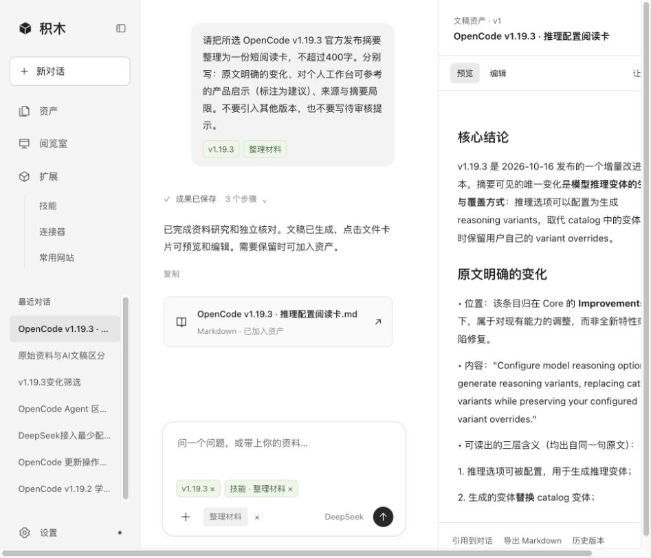

# 积木

**通过对话，把零散材料整理成可复用成果的个人工作台。**

文章、项目记录、招聘 JD 和个人经历往往分散在不同文件里。积木把这些材料集中到资产库，让你在对话中选择材料、引用技能，生成文稿或画板，再预览、修改并保存。不是再建一个聊天工具，而是把「材料 → 对话 → 成果 → 再次引用」连起来。



[主流程演示脚本](docs/demo-script.md)

## 能做什么

- **对话整理**：选择文件或文件夹，引用技能，梳理经历、对照 JD、整理阅读笔记。对话中可查看 Agent 分工和实际工具调用；失败直接显示错误。
- **资产管理**：资料库保存原始材料，创作成果保存整理产物；支持自定义文件夹、子文件夹和拖动移动。文稿可预览、编辑，生成结果由你决定是否加入资产。
- **阅览室**：手动更新公开订阅源，查看带日期的周刊；收藏文章、文件和画板，按自己的分类组织。

## 怎么开发的

从个人材料整理和求职准备出发，通过与 AI 交互完成需求收敛、界面设计、代码实现和流程验证。前端使用原生 HTML/CSS/JavaScript，后端使用 Python 和 SQLite，OpenCode 承担 Agent 执行。

## 接入了什么

接入 DeepSeek 模型与 OpenCode 会话；材料整理按「资料研究 → 文稿生成 → 来源核对」顺序处理，不是并行的自主团队。画板复用 Excalidraw，浏览器扩展用于手动采集网页；GitHub、Browser Use 等 MCP 提供配置入口，实际可用性取决于服务安装、授权与连接测试。

## 怎么复用

克隆后配置自己的 DeepSeek API Key 即可本地使用，不包含作者的密钥、个人文件或聊天记录。任务规则放在 `skills/`，可以从修改技能开始，复用已有的对话、资产和预览流程。

## 本地运行

需要 Python 3.10+、Node.js 18+ 和 npm。以下命令在项目根目录执行：

```sh
git clone https://github.com/Labixy1/jimu-workbench.git
cd jimu-workbench

python3 -m venv .venv
.venv/bin/python -m pip install pypdf pypdfium2
export JIMU_PYTHON="$PWD/.venv/bin/python"

npm install --prefix ui-board
node ui-board/build.mjs
```

从 [OpenCode Releases](https://github.com/anomalyco/opencode/releases) 下载适合自己系统的可执行文件，放到 `vendor/opencode`，macOS/Linux 执行 `chmod +x vendor/opencode`。当前流程基于 OpenCode **1.19.3** 验证，其他版本可能需要适配。

```sh
.venv/bin/python server.py --port 8769
```

打开 `http://127.0.0.1:8769`，在设置中填写 DeepSeek API Key。若 OpenCode 端口被占用，可以追加 `--engine-port 4099`。

**第一次使用**：上传材料 → 新对话中点击 `+` 引用资产和技能 → 发送要求 → 打开生成文件 → 修改后加入资产。浏览器采集扩展的安装方法见 [browser-clipper/README.md](browser-clipper/README.md)。

## 使用边界

- 当前是本地桌面 MVP，没有公网账户、权限隔离和生产部署方案；不要直接开放到公网。
- 文件可以保存，但并非所有格式都能被模型读取：文字材料支持 TXT、MD、DOCX、文字型 PDF 等；图片 OCR、视频转写暂未实现。单文件上限 64 MB，PDF 文字提取最多 40 页。
- DOCX 编辑的是提取后的正文，不是原版式编辑；原始上传文件保留。网站引用不等于自动读取整站，浏览器采集也不等于自动登录或自主操作浏览器。
- 周刊先做手动更新，不做定时任务。模型调用会产生费用，输出需要自行核对。

## 项目结构

```text
web/               界面与交互
server.py          本地服务入口
engine.py          OpenCode 会话与任务分工
skills/            可复用任务规则
ui-board/          Excalidraw 画板
browser-clipper/    手动网页采集扩展
tests/             自动化测试
```

本地数据保存在 `data/` 和 `.runtime/`，不纳入仓库。第三方代码的来源和许可证保留在对应目录；本项目尚未单独指定开源许可证。
